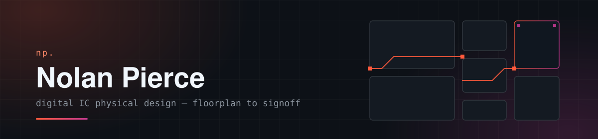

I'm a digital IC **physical design** engineer — floorplan, placement, clock tree, routing, timing signoff.
This account is my open notebook: the problems that actually cost me days, written up so the next
person (usually future me) does not re-debug them. Small tools come out of whatever shows up twice.

**Currently**

- Writing up the awkward parts of backend work — macro placement, ECO structure, closing timing on the first pass
- Maintaining [nolanpix.github.io](https://nolanpix.github.io), a static site with no build step and a left-margin index
- Building a 16-type self-test page that runs entirely in the browser, no backend, no tracking

**Recent notes**

| Note | Topic |
| :--- | :--- |
| [RTL2GDS: synthesis is the easy half](https://nolanpix.github.io/notes/rtl2gds-timing-closed.html) | where the schedule actually goes |
| [Macro placement: local repair beats pushing wirelength](https://nolanpix.github.io/notes/macro-placement-fast-repair.html) | floorplan triage |
| [Structuring ECO work: only three gates](https://nolanpix.github.io/notes/structuring-eco-work.html) | keeping ECOs reviewable |

**Toolbox**

`Innovus` · `PrimeTime` · `Verilog / SystemVerilog` · `Tcl` · `Perl` · `Liberty / SPEF / SDC` · `GitHub Pages`

<picture>
  <source media="(prefers-color-scheme: dark)" srcset="https://raw.githubusercontent.com/nolanpix/nolanpix/output/github-snake-dark.svg" />
  
</picture>

<b>中文简介</b>

数字 IC 物理设计工程师，方向是 floorplan、布局、时钟树、布线和时序签核。
这个账号是一本公开的工程笔记：把真正花掉几天时间的问题写清楚，
顺手把重复出现两次以上的流程做成小工具。笔记在
[nolanpix.github.io](https://nolanpix.github.io)，日常使用 Innovus、PrimeTime、Tcl 和 Perl。

